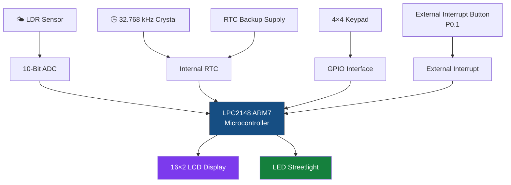
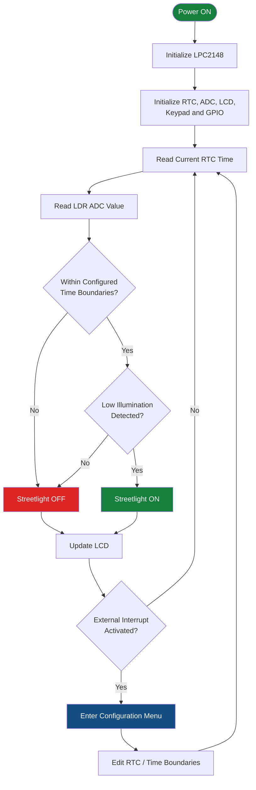

# 🌃 Adaptive Street Light Control Using RTC & LDR

\<p align="center">
&#x20; \
\</p>

\<h3 align="center">Intelligent Streetlight Automation Using LPC2148 ARM7 Microcontroller\</h3>

\<p align="center">
&#x20; \
&#x20; \
&#x20; \
&#x20; \
&#x20; \
&#x20; \
\</p>

---

## 📌 Project Overview

**Adaptive Street Light Control Using RTC and Environmental Illumination** is an embedded systems project developed using the LPC2148 ARM7 microcontroller.

The system automatically controls streetlights based on two important conditions:

- 🕒 **Time-Based Control:** Uses the internal RTC to determine whether the current time is within the user-configured starting and ending boundaries.
- 🌤️ **Light-Based Control:** Uses an LDR sensor and the internal 10-bit ADC to measure surrounding illumination.

A 4×4 keypad provides user interaction through a menu-based configuration system. An external interrupt connected to P0.1 allows the user to enter editing mode.

The current time, date, LDR ADC value, and streetlight status are displayed on a 16×2 LCD.

### 💡 How Does It Work?

\<p align="center">
&#x20; \
\</p>

The streetlight turns ON only when **both the configured time condition and low-illumination condition are satisfied**.

---

## 🎯 Project Objectives

- Implement RTC-based automatic streetlight scheduling.
- Monitor surrounding illumination using an LDR sensor.
- Convert analog sensor voltage into a digital value using the 10-bit ADC.
- Configure RTC date and time through a 4×4 keypad.
- Configure starting and ending time boundaries.
- Implement external interrupt-based menu activation.
- Display real-time information using a 16×2 LCD.
- Reduce unnecessary electricity consumption through adaptive lighting control.

---

## 🧠 System Block Diagram

The following diagram explains how all the hardware modules communicate with the LPC2148 microcontroller.



### System Operation

| Input / Module     | Function                                            |
| ------------------ | --------------------------------------------------- |
| LDR Sensor         | Detects surrounding light intensity                 |
| ADC                | Converts analog voltage into a 10-bit digital value |
| Internal RTC       | Maintains current time and date                     |
| 4×4 Keypad         | Provides menu navigation and configuration          |
| External Interrupt | Activates the editing menu                          |
| 16×2 LCD           | Displays time, date, ADC value, and LED status      |
| LED                | Represents the streetlight                          |

---

## ⚙️ Hardware Requirements

| Component           | Description                   |
| ------------------- | ----------------------------- |
| LPC2148             | ARM7 microcontroller          |
| 16×2 LCD            | Parallel interface display    |
| 4×4 Keypad          | User input                    |
| LDR Sensor          | Light intensity detection     |
| 5 kΩ Resistor       | LDR voltage divider           |
| LED                 | Streetlight representation    |
| 32.768 kHz Crystal  | RTC clock source              |
| 3.3 V Backup Supply | RTC backup power              |
| Push Button         | External interrupt activation |

## 💻 Software Requirements

- Embedded C Programming
- Keil µVision IDE
- Flash Magic
- LPC2148 Development Board

---

## 🔌 Hardware Interfacing

### 1. LPC2148 Microcontroller

The LPC2148 is an ARM7TDMI-S based 32-bit microcontroller from NXP.

It provides the internal peripherals required for this project, including:

- Real-Time Clock (RTC)
- 10-bit ADC
- GPIO
- External Interrupt Controller
- Timers and UART interfaces

### 2. LDR Sensor and ADC

\<p align="center">
&#x20; \
\</p>

An LDR (Light Dependent Resistor) changes its resistance according to the surrounding illumination.

The LDR and 5 kΩ fixed resistor form a voltage divider. The output voltage is connected to the LPC2148 ADC input.

**ADC Specifications:**

| Parameter      | Value          |
| -------------- | -------------- |
| ADC Resolution | 10 bits        |
| Digital Output | 0–1023         |
| Minimum Value  | 0              |
| Maximum Value  | 1023           |
| Input          | Analog voltage |

The measured ADC value is compared with a predefined threshold to determine whether the surrounding environment is sufficiently dark.

*Note: The ADC input channel and physical pin should match the actual development-board wiring.*

### 3. Internal RTC

The LPC2148 internal RTC maintains the following information:

- Seconds
- Minutes
- Hours
- Day
- Date
- Month
- Year

A 32.768 kHz crystal provides the RTC clock source. A backup supply helps maintain RTC operation when the main supply is unavailable.

### 4. External Interrupt

A push button is connected to GPIO pin P0.1.

The external interrupt is configured for falling-edge detection.

When the button is pressed:

1. External interrupt condition is detected.
2. Interrupt flag is set.
3. The interrupt condition is cleared.
4. An editing flag is updated.
5. The main program enters the configuration menu.

The keypad is used for configuration after entering editing mode.

---

## 🖥️ LCD Display Operation

During normal operation, the 16×2 LCD displays the following information:

\<p align="center">
&#x20; \
\</p>

| LCD Information | Description                      |
| --------------- | -------------------------------- |
| Time            | Current hour, minute, and second |
| Date            | Current date, month, and year    |
| ADC Value       | LDR digital reading              |
| LED Status      | Streetlight ON/OFF indication    |

The display continuously updates the RTC information and environmental illumination reading.

---

## 🔔 Configuration Menu

The user can enter editing mode by pressing the external interrupt button.

### Main Menu

| Key | Function                        |
| --- | ------------------------------- |
| 1   | RTC Edit                        |
| 2   | Time Boundaries Edit            |
| 3   | Display Present Time Boundaries |
| 4   | Exit Editing Mode               |

### 1. RTC Editing Menu

The user can individually modify RTC parameters.

| Option | Parameter |
| ------ | --------- |
| 1      | Hour      |
| 2      | Minute    |
| 3      | Second    |
| 4      | Day       |
| 5      | Date      |
| 6      | Month     |
| 7      | Year      |
| 8      | Exit      |

### 2. Starting Time Configuration

Configure the time at which streetlight operation is permitted to begin.

| Option | Parameter             |
| ------ | --------------------- |
| 1      | Starting Hour (S_H)   |
| 2      | Starting Minute (S_M) |
| 3      | Starting Second (S_S) |
| 4      | Exit                  |

### 3. Ending Time Configuration

Configure the time at which streetlight operation is permitted to end.

| Option | Parameter           |
| ------ | ------------------- |
| 1      | Ending Hour (E_H)   |
| 2      | Ending Minute (E_M) |
| 3      | Ending Second (E_S) |
| 4      | Exit                |

### 4. Display Present Time Boundaries

Displays the currently configured starting and ending times on the LCD.

### 5. Exit Editing Mode

Returns the system to normal automatic streetlight operation.

---

## 🔄 Working Principle

The system operates using RTC scheduling and LDR-based illumination detection.

### Automatic Streetlight Control Flowchart



### Streetlight Decision Logic

The streetlight is controlled using two conditions:

| Time Condition          | Light Condition         | Streetlight |
| ----------------------- | ----------------------- | ----------- |
| Outside configured time | Any condition           | OFF         |
| Within configured time  | Sufficient illumination | OFF         |
| Within configured time  | Low illumination        | ON          |

**Control Logic:**

```c
if(time_condition)
{
    if(ldr_value < LDR_THRESHOLD)
    {
        LED_ON();
    }
    else
    {
        LED_OFF();
    }
}
else
{
    LED_OFF();
}
```

*The comparison direction depends on the actual LDR voltage-divider arrangement and ADC readings.*

---

## 📊 Project Features

\<p align="center">
&#x20; \<table>
&#x20;   \<tr>
&#x20;     \<td align="center">🕒\<br>\<b>RTC Scheduling\</b>\<br>Automatic time control\</td>
&#x20;     \<td align="center">🌤️\<br>\<b>LDR Monitoring\</b>\<br>Ambient light detection\</td>
&#x20;   \</tr>
&#x20;   \<tr>
&#x20;     \<td align="center">🔔\<br>\<b>External Interrupt\</b>\<br>Editing mode activation\</td>
&#x20;     \<td align="center">⌨️\<br>\<b>Keypad Interface\</b>\<br>User configuration\</td>
&#x20;   \</tr>
&#x20;   \<tr>
&#x20;     \<td align="center">🖥️\<br>\<b>LCD Display\</b>\<br>Real-time monitoring\</td>
&#x20;     \<td align="center">💡\<br>\<b>Automatic Control\</b>\<br>Adaptive streetlighting\</td>
&#x20;   \</tr>
&#x20; \</table>
\</p>

---

## 📂 Repository Structure

```text
Adaptive-Street-Light-Control-LPC2148/
│
├── ADC/
│   └── ADC driver source and header files
│
├── DELAY/
│   └── Delay driver source and header files
│
├── EXTERNAL_INTERRUPT/
│   └── External interrupt source and header files
│
├── IMAGES/
│   ├── project_banner.png
│   ├── project_setup.jpg
│   ├── block_diagram.png
│   ├── circuit_diagram.png
│   ├── ldr_circuit.png
│   └── lcd_output.jpg
│
├── KEYPAD/
│   └── Keypad driver source and header files
│
├── LCD/
│   └── LCD driver source and header files
│
├── LDR_FILES/
│   └── LDR sensor source and header files
│
├── RTCFILES/
│   └── RTC source and header files
│
└── README.md
```

---

## 📸 Project Demonstration

\<p align="center">   \   \<br>   \<b>Complete Hardware Setup\</b> \</p>

\<p align="center">   \   \<br>   \<b>Hardware Circuit Diagram\</b> \</p>

\<p align="center">
&#x20; \
&#x20; \<br>
&#x20; \<b>LCD Working Output\</b>
\</p>

---

## 🚀 Future Enhancements

- IoT-based remote streetlight monitoring.
- Wireless communication between streetlight systems.
- Automatic fault detection.
- Energy consumption monitoring.
- Solar-powered streetlight integration.

---

## 👨‍💻 Author

\<p align="center">   \<b>G. Jaswanth Kumar\</b>   \<br>   Embedded Systems | ARM7 | LPC2148 | Embedded C   \<br>\<br>   \<i>Designed and implemented as an Embedded Systems project.\</i> \</p>

---

\<p align="center">
&#x20; ⭐ If you find this project useful, consider giving this repository a star!
&#x20; \<br>
&#x20; \<b>Building Intelligent Embedded Systems with ARM7\</b>
\</p>
