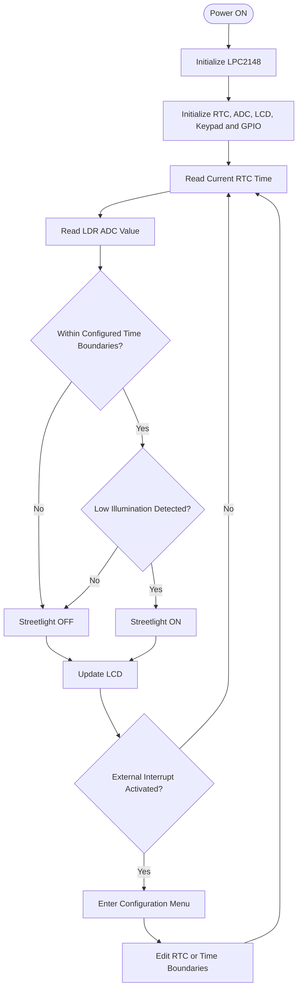

# 🌃 Adaptive Street Light Control Using RTC & LDR

### Intelligent Streetlight Automation Using LPC2148 ARM7 Microcontroller


<p align="center">

**LPC2148 | ARM7 | Embedded C | Keil µVision | RTC | ADC**

</p>

---

## 📌 Project Overview

Adaptive Street Light Control is an embedded systems project developed using the **LPC2148 ARM7 microcontroller**.

The system automatically controls streetlights based on two important parameters:

- 🕒 **Time-Based Control:** Uses the internal Real-Time Clock (RTC) to check whether the current time is within the configured starting and ending time boundaries.
- 🌤️ **Light-Based Control:** Uses an LDR sensor and the internal 10-bit ADC to measure surrounding illumination.

A 4×4 keypad allows users to configure RTC parameters and streetlight operating boundaries. An external interrupt connected to GPIO pin P0.1 activates the configuration menu.

A 16×2 LCD displays the current time, date, LDR ADC reading, and streetlight ON/OFF status.

### 💡 How Does It Work?

The streetlight turns ON only when:

1. The current RTC time is within the configured operating boundaries.
2. The surrounding illumination is below the predefined threshold.

If either condition is not satisfied, the streetlight remains OFF.

---

## 🎯 Project Objectives

- Implement automatic streetlight control using the LPC2148 internal RTC.
- Monitor environmental illumination using an LDR sensor.
- Convert analog sensor voltage into digital values using the 10-bit ADC.
- Configure RTC date and time through a keypad.
- Configure starting and ending time boundaries.
- Implement external interrupt-driven menu activation.
- Display real-time information using a 16×2 LCD.
- Reduce unnecessary energy consumption through adaptive lighting control.

---

## 🧠 System Block Diagram

The following block diagram explains the overall hardware architecture and communication between the different peripherals.


### System Components

| Component | Function |
|---|---|
| LPC2148 | Main ARM7 microcontroller |
| Internal RTC | Maintains current time and date |
| 32.768 kHz Crystal | RTC clock source |
| LDR Sensor | Detects surrounding illumination |
| 10-bit ADC | Converts analog voltage into digital values |
| 4×4 Keypad | User input and menu navigation |
| External Interrupt | Activates configuration mode |
| 16×2 LCD | Displays system information |
| LED | Represents the streetlight |

---

## 🔄 Working Principle

The system follows RTC-based scheduling combined with environmental illumination detection.

### Automatic Streetlight Control Flowchart



### Streetlight Decision Table

| Time Condition | Light Condition | Streetlight |
|---|---|---|
| Outside configured time | Any condition | OFF |
| Within configured time | Sufficient illumination | OFF |
| Within configured time | Low illumination | ON |

---

## ⚙️ Hardware Requirements

| Component | Description |
|---|---|
| LPC2148 | ARM7 microcontroller |
| 16×2 LCD | Parallel interface LCD display |
| 4×4 Keypad | User input |
| LDR Sensor | Environmental illumination detection |
| 5 kΩ Fixed Resistor | LDR voltage divider |
| LED | Streetlight representation |
| 32.768 kHz Crystal | RTC clock source |
| 3.3 V Backup Supply | RTC backup power |
| Push Button | External interrupt activation |

## 💻 Software Requirements

- Embedded C Programming
- Keil µVision IDE
- Flash Magic
- LPC2148 Development Board

---

## 🔌 Hardware Interfacing

### 1. LPC2148 Microcontroller

The LPC2148 is a 32-bit ARM7TDMI-S based microcontroller from NXP.

The following internal peripherals are used in this project:

- Real-Time Clock (RTC)
- 10-bit Analog-to-Digital Converter
- General Purpose Input/Output (GPIO)
- External Interrupt Controller
- Timers

### 2. LDR Sensor and ADC

An LDR (Light Dependent Resistor) changes its resistance depending on the surrounding illumination.

The LDR and 5 kΩ fixed resistor form a voltage divider. The resulting analog voltage is connected to the LPC2148 ADC input.

**ADC Specifications**

| Parameter | Value |
|---|---|
| ADC Resolution | 10 bits |
| Digital Output | 0–1023 |
| Minimum Value | 0 |
| Maximum Value | 1023 |
| Input | Analog voltage |

The ADC reading is compared with a predefined threshold to determine whether the surrounding environment is sufficiently dark.

*Note: The comparison direction depends on the actual voltage-divider arrangement.*

### 3. Internal RTC

The LPC2148 internal RTC maintains the following parameters:

- Seconds
- Minutes
- Hours
- Day
- Date
- Month
- Year

A 32.768 kHz crystal provides the RTC clock source. A backup supply helps maintain RTC operation when the main supply is unavailable.

### 4. External Interrupt

A push button is connected to GPIO pin P0.1.

The external interrupt is configured for falling-edge detection.

When the button is pressed:

1. External interrupt condition is detected.
2. Interrupt flag is set.
3. Interrupt condition is cleared.
4. An editing flag is updated.
5. The main program detects the flag and enters the configuration menu.

The keypad is then used for menu navigation and configuration.

---

## 🖥️ LCD Display Operation

During normal operation, the 16×2 LCD displays:

- Current hour, minute and second.
- Date, month and year.
- LDR ADC reading.
- Streetlight ON/OFF status.

The LCD continuously updates RTC information and environmental illumination readings.

---

## 📸 Project Hardware Demonstration

### 1. Complete LPC2148 Hardware Setup

The following image shows the actual LPC2148 development board with the interfacing connections used in this project.


### 2. RTC Time Display


### 3. RTC Editing Menu


### 4. RTC Time Editing


### 5. Hour Editing


### 6. Time Boundaries Display


### 7. Time Boundaries Editing


## 🔔 External Interrupt-Driven Configuration

The user can enter editing mode by pressing the external interrupt button connected to P0.1.

### Main Configuration Menu

| Option | Function |
|---|---|
| 1 | RTC Edit |
| 2 | Time Boundaries Edit |
| 3 | Display Present Time Boundaries |
| 4 | Exit Editing Mode |

### 1. RTC Editing Menu

The RTC editing menu allows individual modification of date and time parameters.

| Option | Parameter |
|---|---|
| 1 | Hour |
| 2 | Minute |
| 3 | Second |
| 4 | Day |
| 5 | Date |
| 6 | Month |
| 7 | Year |
| 8 | Exit |

### 2. Starting Time Configuration

The user can configure the starting time for streetlight operation.

| Option | Parameter |
|---|---|
| 1 | Starting Hour (S_H) |
| 2 | Starting Minute (S_M) |
| 3 | Starting Second (S_S) |
| 4 | Exit |

### 3. Ending Time Configuration

The user can configure the ending time for streetlight operation.

| Option | Parameter |
|---|---|
| 1 | Ending Hour (E_H) |
| 2 | Ending Minute (E_M) |
| 3 | Ending Second (E_S) |
| 4 | Exit |

### 4. Display Present Time Boundaries

Displays the currently configured starting and ending time boundaries on the LCD.

### 5. Exit Editing Mode

Exits the configuration menu and returns the system to normal automatic streetlight operation.

---

## 💡 Streetlight Control Logic

The streetlight is controlled using two conditions:

```c
if(time_condition)
{
    if(ldr_value < LDR_THRESHOLD)
    {
        LED_ON();
    }
    else
    {
        LED_OFF();
    }
}
else
{
    LED_OFF();
}
```

The streetlight turns ON only when the configured time condition and low-illumination condition are both satisfied.

*The ADC comparison direction depends on the actual LDR circuit.*

---

## ✨ Key Features

| Feature | Description |
|---|---|
| RTC Scheduling | Automatic time-based streetlight operation |
| LDR Monitoring | Environmental illumination detection |
| 10-bit ADC | Analog-to-digital conversion |
| External Interrupt | Configuration menu activation |
| Keypad Interface | User-configurable settings |
| RTC Editing | Individual date and time modification |
| Time Boundaries | Configurable starting and ending times |
| LCD Display | Real-time system monitoring |
| Automatic Control | Time and illumination-based LED control |
| RTC Backup | Maintains RTC operation using backup supply |

---

## 📂 Repository Structure

```text
Adaptive-Street-Light-Control-LPC2148/
│
├── ADC/
│   └── ADC driver source and header files
│
├── DELAY/
│   └── Delay driver source and header files
│
├── EXTERNAL_INTERRUPT/
│   └── External interrupt source and header files
│
├── IMAGES/
│   ├── hardware_setup.jpg
│   ├── system_block_diagram.png
│   ├── rtc_time_display.jpg
│   ├── rtc_editing_menu.jpg
│   ├── rtc_time_edit_menu.jpg
│   ├── hour_editing.jpg
│   ├── time_boundaries_display.jpg
│   ├── time_boundaries_edit_menu.jpg
│   └── ldr_adc_reading.jpg
│
├── KEYPAD/
│   └── Keypad driver source and header files
│
├── LCD/
│   └── LCD driver source and header files
│
├── LDR_FILES/
│   └── LDR sensor source and header files
│
├── RTCFILES/
│   └── RTC source and header files
│
└── README.md
```

---

## 🚀 Future Enhancements

- IoT-based remote streetlight monitoring.
- Wireless communication between streetlight systems.
- Automatic fault detection.
- Energy consumption monitoring.
- Solar-powered streetlight integration.

---

## 👨‍💻 Author

**G. Jaswanth Kumar**

Embedded Systems | ARM7 | LPC2148 | Embedded C | Microcontroller Programming

---

⭐ If you find this project useful, consider giving this repository a star!

**Building Intelligent Embedded Systems with ARM7.**
